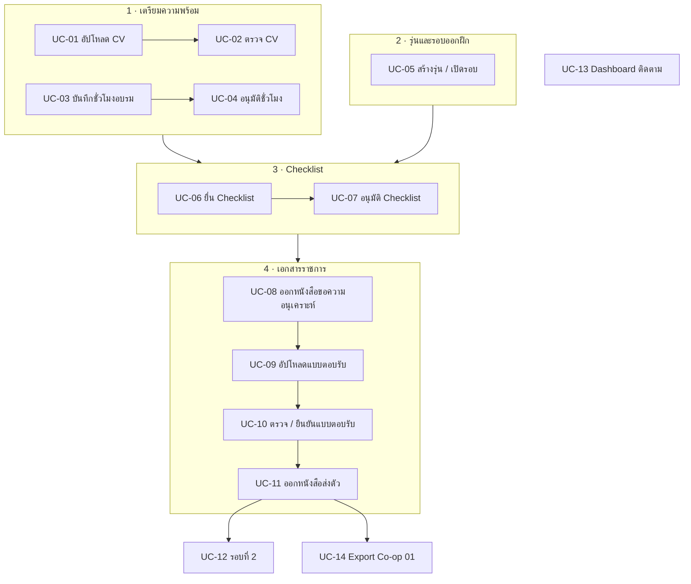

# 03 · ขั้นตอนการใช้งาน (Use Cases)

> เรียง Use Case ตามลำดับเวลาที่เกิดขึ้นจริง ตั้งแต่เตรียมความพร้อมจนออกหนังสือส่งตัว
> **หน้าจอ Demo** = หน้าที่จะคลิกให้ดูในวันประชุม · **BR-xx** = กฎใน [01_BUSINESS_RULES.md](01_BUSINESS_RULES.md)

## ภาพรวม

## รายการ Use Case ทั้งหมด

| รหัส | ชื่อ | ผู้ใช้หลัก | สถานะ |
|---|---|---|:---:|
| UC-01 | อัปโหลด / แก้ไข CV | นิสิต | ✅ |
| UC-02 | ตรวจและอนุมัติ CV | อ.ที่ปรึกษา | ✅ |
| UC-03 | บันทึกชั่วโมงอบรม | นิสิต | ✅ |
| UC-04 | อนุมัติชั่วโมงอบรม | อ.ที่ปรึกษา | ✅ |
| UC-05 | สร้างรุ่น และเปิด/ปิดรอบออกฝึกรายสาขา | เจ้าหน้าที่ | ✅ |
| UC-06 | ยื่น Checklist สถานประกอบการ | นิสิต | ✅ |
| UC-07 | อนุมัติ / ตีกลับ Checklist | อ.ที่ปรึกษา | ✅ |
| UC-08 | ออกหนังสือขอความอนุเคราะห์ | เจ้าหน้าที่ | ✅ |
| UC-09 | อัปโหลดแบบตอบรับ | นิสิต | ✅ |
| UC-10 | ตรวจและยืนยันแบบตอบรับ | อ.ที่ปรึกษา, เจ้าหน้าที่ | ✅ |
| UC-11 | ออกหนังสือส่งตัว | เจ้าหน้าที่ | ✅ |
| UC-12 | ฝึกงานรอบที่ 2 / นิสิตตกค้าง | นิสิต, เจ้าหน้าที่ | ✅ |
| UC-13 | ติดตามสถานะผ่าน Dashboard | อ.ที่ปรึกษา, อ.ประจำวิชา, เจ้าหน้าที่, ผู้บริหาร | 🔴 (\*) |
| UC-14 | Export Co-op 01 ส่งระบบกลาง | เจ้าหน้าที่ | 🔴 (\*) |
| UC-15 | นำเข้ารายชื่อนิสิตและกำหนดอาจารย์ที่ปรึกษา | อ.ประจำวิชา, เจ้าหน้าที่ | ✅ |
| UC-16 | ⏸ ลงทะเบียนอบรม / สแกน QR เช็คอิน | นิสิต, เจ้าหน้าที่ | 🔴 (\*) |

---

## รายละเอียด Use Case

### UC-01 · อัปโหลด / แก้ไข CV
- **ผู้ใช้:** นิสิต
- **เงื่อนไขก่อนเริ่ม:** เข้าสู่ระบบแล้ว และกรอกข้อมูลส่วนตัวแล้ว
- **ขั้นตอนหลัก:**
  1. นิสิตเปิดหน้า CV
  2. อัปโหลดไฟล์ PDF
  3. ระบบบันทึกไฟล์ และตั้งสถานะเป็น "รอตรวจ"
- **กรณีอื่น:** ช่วงที่กำลังฝึกงาน ระบบล็อกไม่ให้แก้ไข และแสดงข้อความแจ้ง (BR-14)
- **หน้าจอ Demo:** หน้า CV ของนิสิต

### UC-02 · ตรวจและอนุมัติ CV
- **ผู้ใช้:** อาจารย์ที่ปรึกษา (อาจารย์ประจำวิชาทำแทนได้)
- **ขั้นตอนหลัก:**
  1. อาจารย์เปิด Dashboard
  2. เลือกนิสิต
  3. เปิดดู CV
  4. กด "ผ่าน" หรือ "ไม่ผ่าน" พร้อมความเห็น
- **กรณีอื่น:** ถ้าไม่ผ่าน นิสิตแก้ไขและอัปโหลดใหม่ได้
- **กฎที่เกี่ยวข้อง:** BR-10
- **หน้าจอ Demo:** Dashboard อาจารย์ที่ปรึกษา

### UC-03 · บันทึกชั่วโมงอบรม
- **ผู้ใช้:** นิสิต
- **ขั้นตอนหลัก:**
  1. นิสิตเพิ่มรายการอบรม (ชื่อกิจกรรม, ประเภท Soft/Hard, จำนวนชั่วโมง)
  2. แนบใบประกาศ
  3. ระบบแสดงชั่วโมงสะสมเทียบกับเกณฑ์ 12/18
- **กรณีอื่น:** ช่วงที่กำลังฝึกงาน ระบบล็อกไม่ให้แก้ไข (BR-14)
- **กฎที่เกี่ยวข้อง:** BR-11, BR-13
- **หน้าจอ Demo:** หน้าชั่วโมงอบรม และหน้าสถานะรวมของนิสิต

### UC-04 · อนุมัติชั่วโมงอบรม
- **ผู้ใช้:** อาจารย์ที่ปรึกษา (อาจารย์ประจำวิชาทำแทนได้)
- **ขั้นตอนหลัก:**
  1. อาจารย์ตรวจรายการและใบประกาศ
  2. อนุมัติหรือไม่อนุมัติ โดยทำทีละรายการหรือหลายรายการพร้อมกันได้
- **หน้าจอ Demo:** Dashboard อาจารย์ที่ปรึกษา

### UC-05 · สร้างรุ่น และเปิด/ปิดรอบออกฝึกรายสาขา
- **ผู้ใช้:** เจ้าหน้าที่ฝ่ายฝึกงาน
- **ขั้นตอนหลัก:**
  1. สร้างรุ่นใหม่ เช่น รุ่น 68 (คัดลอกรอบจากรุ่นก่อนได้ โดยระบบเลื่อนปีให้อัตโนมัติ)
  2. กำหนดรอบของแต่ละสาขา: เทอม, วันเปิด, วันปิด, วันสิ้นสุดการฝึก, รอบปกติหรือ Summer
  3. กด "ปลดล็อก" ให้นิสิตเริ่มยื่น Checklist
- **กรณีอื่น:**
  - เลยวันปิด → ระบบล็อกให้อัตโนมัติ เจ้าหน้าที่สั่ง "เปิดต่อพิเศษ" ได้ (BR-22)
  - กด "จบรอบ" เมื่อการฝึกเสร็จสิ้น (BR-23)
  - **ปิดรุ่น** → ระบบแสดงรายชื่อนิสิตที่ยังไม่ได้หนังสือส่งตัวให้ตรวจก่อน แล้วตั้งเป็น "ตกค้าง" (BR-54)
- **หน้าจอ Demo:** หน้าผู้ดูแล → แท็บ "รอบฝึกงาน & ปลดล็อก"

### UC-06 · ยื่น Checklist สถานประกอบการ
- **ผู้ใช้:** นิสิต
- **เงื่อนไขก่อนเริ่ม:** สาขาของนิสิตมีรอบที่เปิดอยู่ (BR-20)
- **ขั้นตอนหลัก:**
  1. กรอกข้อมูลบริษัทและตำแหน่งงาน (ค้นหาตำแหน่งจากรายการมาตรฐานได้)
  2. ตอบแบบประเมิน 5 ด้าน
  3. กดส่ง ระบบผูกนิสิตกับรอบออกฝึกให้อัตโนมัติ (BR-24)
- **กรณีอื่น:**
  - รอบยังปิดอยู่ → ยื่นไม่ได้ ระบบแสดงข้อความแจ้ง
  - เปิดหลายรอบพร้อมกัน หรือเป็นนิสิตตกค้าง → นิสิตเลือกรอบเอง
  - ยื่นได้ครั้งละ 1 บริษัทเท่านั้น (BR-30)
- **หน้าจอ Demo:** หน้า Checklist ของนิสิต

### UC-07 · อนุมัติ / ตีกลับ Checklist
- **ผู้ใช้:** อาจารย์ที่ปรึกษา **ของนิสิตคนนั้นเท่านั้น** (BR-32)
- **ขั้นตอนหลัก:**
  1. อาจารย์เปิดรายการ Checklist ที่รอตรวจ
  2. อ่านข้อมูลบริษัทและคำตอบ
  3. กดอนุมัติ หรือตีกลับพร้อมความเห็น
- **กรณีอื่น:** ถ้าตีกลับ นิสิตแก้ไขแล้วส่งใหม่ได้
- **ประเด็นต้องเคาะ:** 🔴 (\*) จะแจ้งเตือนอาจารย์ช่องทางใด เมื่อมี Checklist ใหม่ (OI-06)
- **หน้าจอ Demo:** หน้าตรวจ Checklist ของอาจารย์

### UC-08 · ออกหนังสือขอความอนุเคราะห์
- **ผู้ใช้:** เจ้าหน้าที่ฝ่ายฝึกงาน
- **เงื่อนไขก่อนเริ่ม:** Checklist ได้รับอนุมัติแล้ว
- **ขั้นตอนหลัก:**
  1. เจ้าหน้าที่เปิด "คิวออกหนังสือ" ซึ่งจัดกลุ่มตามบริษัท และกรองตามรุ่น สาขา รอบออกฝึก หรือสถานะได้
  2. เลือกบริษัท
  3. ระบบสร้างหนังสือตามแบบราชการ พร้อมแบบตอบรับ
  4. ดาวน์โหลดเป็น PDF
- **กรณีอื่น:** นิสิตหลายคนไปบริษัทเดียวกัน → ออกเป็นฉบับเดียวได้ (BR-40)
- **หน้าจอ Demo:** หน้าผู้ดูแล → แท็บ "คิวออกหนังสือ"

### UC-09 · อัปโหลดแบบตอบรับ
- **ผู้ใช้:** นิสิต
- **ขั้นตอนหลัก:** นิสิตอัปโหลดแบบตอบรับที่บริษัทกรอกแล้ว
- **หน้าจอ Demo:** หน้าสถานะรวมของนิสิต

### UC-10 · ตรวจและยืนยันแบบตอบรับ
- **ผู้ใช้:** อาจารย์ที่ปรึกษา → เจ้าหน้าที่ฝ่ายฝึกงาน
- **ขั้นตอนหลัก:**
  1. อาจารย์ที่ปรึกษาตรวจแบบตอบรับ
  2. เจ้าหน้าที่ยืนยันผล โดยระบบ OCR ช่วยอ่านว่าบริษัท "รับ" หรือ "ไม่รับ"
- **กรณีอื่น:** บริษัทปฏิเสธ → เก็บเข้าประวัติ แล้วนิสิตกลับไปยื่น Checklist บริษัทใหม่ (BR-42)
- **หน้าจอ Demo:** คิวออกหนังสือ (ขั้นแบบตอบรับ)

### UC-11 · ออกหนังสือส่งตัว
- **ผู้ใช้:** เจ้าหน้าที่ฝ่ายฝึกงาน
- **เงื่อนไขก่อนเริ่ม:** บริษัทตอบรับแล้ว
- **ขั้นตอนหลัก:** เจ้าหน้าที่ออกหนังสือส่งตัวและดาวน์โหลดเป็น PDF
- **ผลที่ตามมา:** นิสิตเข้าสู่สถานะ "กำลังฝึกงาน" และระบบล็อก CV/ชั่วโมงอบรมจนกว่าจะจบรอบ (BR-14)
- **หน้าจอ Demo:** คิวออกหนังสือ

### UC-12 · ฝึกงานรอบที่ 2 / นิสิตตกค้าง
- **ผู้ใช้:** นิสิต (และเจ้าหน้าที่ในกรณีตั้งสถานะตกค้าง)
- **ขั้นตอนหลัก:**
  1. นิสิตที่จบรอบที่ 1 กดเริ่มรอบที่ 2
  2. เลือก **"ฝึกที่เดิม"** หรือ **"เปลี่ยนที่ใหม่"**
  3. เลือกรอบออกฝึก (ถ้าเปิดรอบเดียว ระบบเลือกให้อัตโนมัติ)
- **ผลลัพธ์:**
  - ฝึกที่เดิม → เริ่มที่ขั้นหนังสือขอความอนุเคราะห์ (BR-52)
  - เปลี่ยนที่ใหม่ → เริ่ม Checklist ใหม่ (BR-53)
  - ประวัติรอบที่ 1 และชั่วโมงอบรมยังอยู่ครบ (BR-51, BR-13)
- **นิสิตตกค้าง:** เจ้าหน้าที่หรืออาจารย์ประจำวิชาตั้งสถานะในหน้ารายละเอียดนิสิต แล้วนิสิตยื่นรอบของรุ่นถัดไปได้ (BR-55)
- **หน้าจอ Demo:** Dashboard นิสิต และหน้ารายละเอียดนิสิต (ฝั่งผู้ดูแล)

### UC-13 · ติดตามสถานะผ่าน Dashboard
- **ผู้ใช้:** อาจารย์ที่ปรึกษา, อาจารย์ประจำวิชา, เจ้าหน้าที่, ผู้บริหาร
- **ขั้นตอนหลัก:** เปิด Dashboard → ดูจำนวนนิสิตแยกตามขั้นตอน → กรองตามรุ่น สาขา รอบออกฝึก หรือสถานะ → เปิดดูรายบุคคล
- **ประเด็นต้องเคาะ:** 🔴 (\*)
  - ผู้บริหารต้องการเห็นตัวเลขอะไรบ้าง
  - ต้องมีหน้าแยกหรือไม่ (OI-04)
  - อาจารย์ประจำวิชาเห็นเฉพาะสาขาตัวเองหรือไม่ (OI-03)
- **หน้าจอ Demo:** หน้าผู้ดูแล → แท็บ "ภาพรวม" และ Dashboard อาจารย์ที่ปรึกษา

### UC-14 · Export Co-op 01 ส่งระบบกลาง
- **ผู้ใช้:** เจ้าหน้าที่ฝ่ายฝึกงาน
- **ขั้นตอนหลัก:**
  1. เปิดแท็บ Co-op
  2. กรองตามรุ่น สาขา หรือรอบออกฝึก
  3. ตรวจรายชื่อ
  4. Export ไฟล์
- **ประเด็นต้องเคาะ:** 🔴 (\*) รูปแบบไฟล์และช่องข้อมูลที่ระบบกลางต้องการ (OI-07)
- **หน้าจอ Demo:** หน้าผู้ดูแล → แท็บ "Co-op"

### UC-15 · นำเข้ารายชื่อนิสิตและกำหนดอาจารย์ที่ปรึกษา
- **ผู้ใช้:** อาจารย์ประจำวิชา, เจ้าหน้าที่
- **ขั้นตอนหลัก:**
  1. อัปโหลดไฟล์ Excel
  2. ระบบแสดงตัวอย่างและปรับชื่อสาขาให้เป็นมาตรฐาน
  3. กดยืนยันการนำเข้า
  4. อาจารย์ประจำวิชากำหนดอาจารย์ที่ปรึกษาให้นิสิต
- **หน้าจอ Demo:** หน้าผู้ดูแล → แท็บ "ภาพรวม"

### UC-16 · ⏸ ลงทะเบียนอบรม / สแกน QR เช็คอิน (ระยะถัดไป)
- **ขอบเขตที่เสนอ:**
  - เปิดลงทะเบียน 3 วันก่อนกิจกรรม พร้อมโควตาที่นั่งจริงและที่นั่งสำรอง
  - สแกน QR ตอนเข้าและออกงาน เพื่อบันทึกชั่วโมงอัตโนมัติ
  - Export รายชื่อผู้เข้าอบรม
- **สถานะ:** 🔴 (\*) ยังไม่พัฒนา รอที่ประชุมตัดสินว่าอยู่ในขอบเขตหรือไม่ (OI-02)
