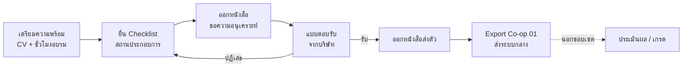

# เอกสาร Requirement — ระบบติดตามการฝึกงาน คณะ ICT มหาวิทยาลัยพะเยา

> **ฉบับร่างสำหรับประชุมเคาะ Requirement ร่วมกับตัวแทนอาจารย์ทุกสาขา**
> ปรับปรุงล่าสุด: 13 พฤศจิกายน 2569 · จัดทำโดยทีมนิสิตผู้พัฒนาระบบ

## เอกสารชุดนี้มีไว้ทำอะไร

ทีมพัฒนาขอให้อาจารย์ **อ่านล่วงหน้าก่อนวันประชุม Demo** เพื่อให้เวลาในห้องประชุมใช้กับเรื่องที่ยังไม่ได้ข้อสรุปเท่านั้น

1. **ให้ทุกฝ่ายเห็นภาพระบบตรงกัน:** อาจารย์ทุกสาขา ผู้บริหาร และเจ้าหน้าที่ฝ่ายฝึกงาน
2. **แยกให้ชัดว่าเรื่องไหนตกลงแล้ว และเรื่องไหนยังต้องเคาะ**
3. **เก็บ Feedback ของแต่ละสาขาเป็นลายลักษณ์อักษร** เพื่อป้องกันการรื้อระบบภายหลัง
4. **ใช้เป็นฐานของ** หน้าจอ Demo, เอกสาร Proposal (สอบหัวข้อ 1–25 ธ.ค. 2569) และ Test Case

> **หมายเหตุ:** ช่วงนี้ทีมชะลอการพัฒนาระบบหลังบ้านไว้ก่อน จนกว่า Requirement จากที่ประชุมจะนิ่ง

## ลำดับการอ่าน (ใช้เวลาประมาณ 20 นาที)

| ลำดับ | ไฟล์ | เนื้อหา | สิ่งที่อยากให้อาจารย์ช่วยดู |
|:---:|---|---|---|
| 1 | [01_BUSINESS_RULES.md](01_BUSINESS_RULES.md) | กฎและเงื่อนไขของการฝึกงาน | กฎข้อไหนไม่ตรงกับสาขาของอาจารย์ |
| 2 | [02_ROLE_MATRIX.md](02_ROLE_MATRIX.md) | ผู้ใช้แต่ละบทบาททำอะไรได้บ้าง | หน้าที่ของอาจารย์ถูกต้องหรือไม่ ขาดหรือเกินตรงไหน |
| 3 | [03_USE_CASES.md](03_USE_CASES.md) | ขั้นตอนการใช้งานตั้งแต่เตรียมตัวจนออกหนังสือส่งตัว | ขั้นตอนตรงกับการทำงานจริงหรือไม่ |
| 4 | [04_OPEN_ISSUES.md](04_OPEN_ISSUES.md) | **คำถามที่ต้องเคาะในวันประชุม** (ใช้เป็นวาระประชุม) | เตรียมคำตอบหรือข้อยกเว้นของสาขามาล่วงหน้า |

## สัญลักษณ์ที่ใช้ในเอกสาร

| สัญลักษณ์ | ความหมาย |
|:---:|---|
| ✅ | ยืนยันแล้ว / มีในระบบแล้ว |
| 🟡 | มีในระบบหรือในแบบร่างแล้ว แต่ขอให้ที่ประชุมยืนยันอีกครั้ง |
| 🔴 **(\*)** | **ยังไม่ชัดเจน ต้องเคาะในที่ประชุม** (มีรายละเอียดใน 04_OPEN_ISSUES.md) |
| ⏸ | พักไว้ / อยู่ในระยะถัดไป |

## ขอบเขตของระบบ (สรุป 1 บรรทัด)

ระบบนี้ดูแลตั้งแต่ **"นิสิตเตรียมความพร้อม" จนถึง "ออกหนังสือส่งตัว + ส่งออกข้อมูล Co-op 01"** ส่วนการประเมินผลและการให้เกรด ทำในระบบ Co-op กลางของมหาวิทยาลัย

## หลังวันประชุม

ทีมจะบันทึกผลการประชุมลงในไฟล์เหล่านี้ ข้อที่ได้ข้อสรุปแล้วจะย้ายจาก 🔴 เป็น ✅ และบันทึกไว้ใน **บันทึกการตัดสินใจ** ท้ายไฟล์ [04_OPEN_ISSUES.md](04_OPEN_ISSUES.md) จากนั้นทีมจึงจะเริ่มพัฒนาระบบหลังบ้านในส่วนที่ชัดเจนแล้ว
